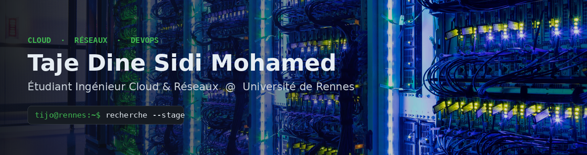

<p align="center">
  
</p>

<h3 align="center">👋 Taje Dine Sidi Mohamed — <i>TIJO</i></h3>

<p align="center">
  
</p>

<p align="center">
  <a href="https://www.linkedin.com/in/taje-dine-sidi-mohamed-5828a8341/">
    
  </a>
  <a href="mailto:tajedinesidimohamed@gmail.com">
    
  </a>
  
</p>

---

## 🖥️ Statut système

```console
$ systemctl status tijo.service
● tijo.service - Taje Dine Sidi Mohamed · M1 Cloud & Networks Student
     Loaded: loaded (/etc/universite-de-rennes/master-cloud-reseaux.conf; enabled)
     Active: active (running) — disponible pour un stage de M1
   Main PID: 2026 (curiosity)
      Tasks: Cloud · DevOps · Réseaux · Observabilité
     Memory: Linux, Docker, Kubernetes, Nginx, Kafka, ELK, Spring Boot
     CGroup: /projets
             ├─ microservices-ha-cluster.service   ● active
             ├─ elk-log-monitoring.service         ● active
             ├─ kafka-streaming-pipeline.service   ● active
             ├─ network-automation-lab.service     ● starting
             └─ aws-multi-tier-terraform.service   ○ planned

$ journalctl -u tijo.service --no-pager | tail -4
[INFO]  Expérience : 2 stages back-end (Spring Boot, RabbitMQ, Docker, MongoDB)
[INFO]  Objectif   : concevoir des infrastructures de bout en bout, du câble au cloud
[INFO]  Langues    : Arabe · Français · Anglais (B2)
[OK]    Prêt à rejoindre une équipe Cloud / DevOps / Réseau en stage
```

---

## 🎬 Comment ça marche — Architectures en action

<p align="center">
  
</p>

---

## 🛠️ Compétences techniques

### ☁️ Cloud, Conteneurs & Orchestration

<p align="left">
  
</p>

### 🌐 Réseaux, Systèmes & Protocoles

<p align="left">
  
</p>

<p align="left">
  
  
  
  
  
  
  
</p>

### ⚡ Data Streaming & Code

<p align="left">
  
</p>

<p align="left">
  
</p>

### ⚙️ Back-end & Bases de données

<p align="left">
  
</p>

### 📈 Observabilité — Stack ELK

<p align="left">
  
  
  
</p>

### 🌱 En cours d'apprentissage

<p align="left">
  
  
  
</p>

---

## 🚀 Projets phares — Hybride Cloud & Réseaux

| Projet | Description | Stack | Statut |
|:--|:--|:--|:--:|
| 🔀 **[Microservices High-Availability Cluster](https://github.com/tajedinesidimohamed/microservices-ha-cluster)** | Architecture microservices derrière un load balancer Nginx en HTTPS : un serveur tombe, le trafic bascule automatiquement. | Docker · Nginx · TLS · Kubernetes | ✅ Terminé |
| 📈 **[ELK Log Monitoring](https://github.com/tajedinesidimohamed/elk-log-monitoring)** | Centralisation des logs web, dashboards Kibana et détection d'une attaque par force brute simulée. | Elasticsearch · Logstash · Kibana · Filebeat | ✅ Terminé |
| ⚡ **[Realtime Kafka Streaming Pipeline](https://github.com/tajedinesidimohamed/kafka-streaming-pipeline)** | Cluster Kafka à 3 brokers tolérant aux pannes, consommateurs en parallèle et analyse MapReduce. | Kafka · Python · MapReduce · Docker | ✅ Terminé |
| 🌐 **[Enterprise Network Automation Lab](https://github.com/tajedinesidimohamed/network-automation-lab)** | Réseau d'entreprise segmenté (VLANs, DNS, DHCP, OSPF, BGP), configuré par Ansible et validé par des tests. | Containerlab · FRR · Ansible · Python | 🛠️ En cours |
| ☁️ **Cloud Multi-Tier Infra (AWS)** | VPC sécurisé provisionné par code : subnets publics/privés, routage, ALB. | Terraform · AWS | 📅 Prochainement |

---

## 📊 Statistiques GitHub

<p align="center">
  
  
</p>

<p align="center">
  <picture>
    <source media="(prefers-color-scheme: dark)" srcset="https://raw.githubusercontent.com/tajedinesidimohamed/tajedinesidimohamed/output/github-snake-dark.svg"/>
    <source media="(prefers-color-scheme: light)" srcset="https://raw.githubusercontent.com/tajedinesidimohamed/tajedinesidimohamed/output/github-snake.svg"/>
    
  </picture>
</p>

---

<p align="center">
  <i>« Automatiser, versionner, superviser : du câble au cloud. »</i>
</p>
